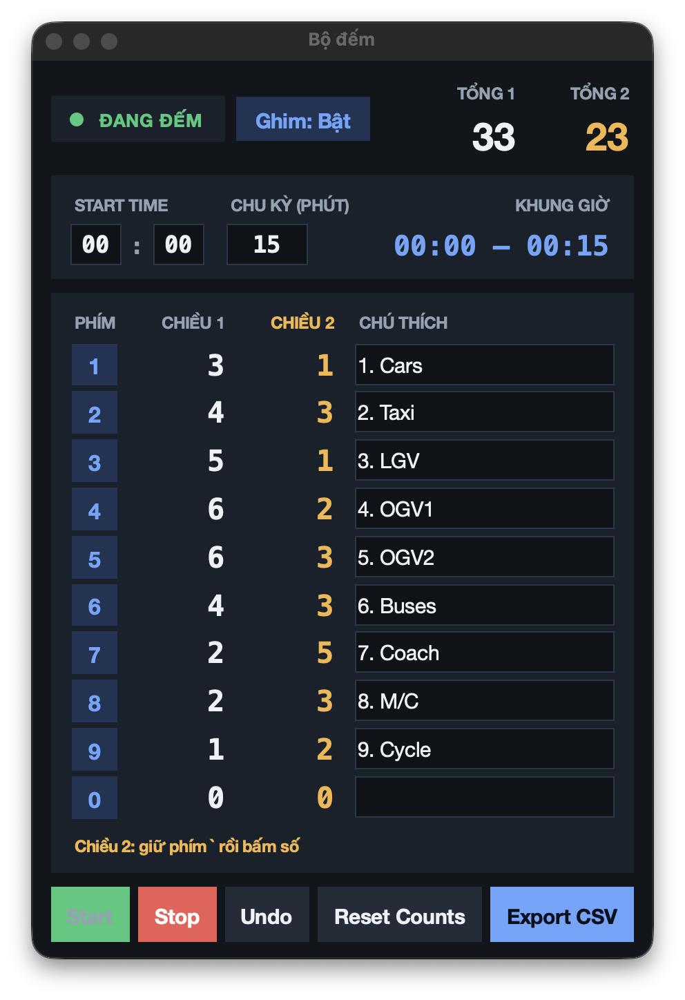

# Numpad Cycle Counter


Bộ đếm phím số theo chu kỳ, **đếm được cả khi bạn đang làm việc ở ứng dụng khác**. Mỗi chu kỳ (mặc định 15 phút) bạn xuất một dòng vào file CSV. Phù hợp cho khảo sát, kiểm đếm hay ghi nhận nhanh bằng bàn phím.



## Tính năng

- Đếm phím **0–9** ở mọi ứng dụng (hàng số phía trên và bàn phím số), chỉ khi đang **Start**.
- Mỗi phím có ô **chú thích**; chú thích trở thành tên cột trong CSV.
- **Start Time** (giờ, phút) và **chu kỳ** (phút, mặc định 15) quyết định khung giờ của từng dòng.
- **Undo** nhiều bước, **Reset Counts**, **Stop**.
- **Export CSV** ghi tiếp một dòng vào cuối file (tạo file kèm tiêu đề nếu chưa có), đưa số đếm về 0 và sang chu kỳ kế tiếp.
- Cửa sổ nhỏ luôn nằm trên cùng, kéo to nhỏ tuỳ ý (chữ co giãn theo cửa sổ).
- Mỗi lần mở, mọi thứ bắt đầu lại từ đầu: 00:00, chu kỳ 15 phút, chú thích trống. Script không lưu gì ngoài file CSV.

## Cài đặt (macOS)

1. Cài Python 3.10+ từ [python.org](https://www.python.org/downloads/). Bản Python có sẵn của macOS dùng Tk cũ nên cửa sổ dễ lỗi.
2. Tải mã nguồn và cài thư viện:

   ```bash
   git clone https://github.com/ancodetest08/numpad-cycle-counter.git
   cd numpad-cycle-counter
   pip3 install -r requirements.txt
   ```

3. Cấp quyền cho ứng dụng Terminal (hoặc iTerm): **System Settings › Privacy & Security** › bật **Input Monitoring** và **Accessibility**, rồi đóng và mở lại Terminal. Không có hai quyền này macOS sẽ không cho script thấy phím.

## Sử dụng

```bash
python3 counter.py
```

1. Nhập **Start Time**, **chu kỳ** và **chú thích** cho các phím bạn cần.
2. Nhấn **Start**, rồi chuyển sang ứng dụng khác và gõ các số 0–9.
3. Hết chu kỳ, bấm **Export CSV**. Hết phiên, bấm **Stop**.

Lưu ý:

- Khi cửa sổ đếm đang được chọn (ví dụ lúc gõ chú thích), phím số **không** được đếm.
- Chỉ các phím **có chú thích** được ghi vào CSV. Ô **TỔNG** trên cửa sổ và cột **Total** trong file đều là tổng của các phím có chú thích, nên hai con số luôn khớp nhau.
- Phải nhập ít nhất một chú thích mới xuất được file.

### Tuỳ chọn

| Tuỳ chọn | Ý nghĩa |
| --- | --- |
| `--out ĐƯỜNG_DẪN` | File CSV cần ghi tiếp (mặc định `counts_survey.csv` cạnh script) |
| `--keypad-only` | Chỉ đếm bàn phím số rời, bỏ qua hàng số phía trên |

### Định dạng CSV

```csv
Start Time,End Time,Nam,Nữ,Total
00:00,00:15,12,9,21
00:15,00:30,7,14,21
```

File có BOM nên Excel và Numbers đọc đúng tiếng Việt. Nếu các cột chú thích hiện tại khác tiêu đề của file đã có, script sẽ hỏi trước khi ghi tiếp.

## Quyền riêng tư

Để đếm phím ở mọi ứng dụng, script dùng [pynput](https://pypi.org/project/pynput/) lắng nghe **toàn bộ** phím bấm của hệ thống. Script chỉ xử lý các phím số 0–9; mọi phím khác bị bỏ qua ngay ở bước kiểm tra đầu tiên: không lưu (kể cả tạm thời), không ghi log và không gửi đi đâu (script không dùng mạng). Mã nguồn ngắn, bạn có thể đọc trước khi chạy (xem hàm `on_press` trong `counter.py`).

## Giới hạn

- Chỉ hỗ trợ **macOS**. Chạy trên hệ điều hành khác, script sẽ báo lỗi và thoát.
- Số đếm chưa Export sẽ mất khi đóng cửa sổ.
- Chu kỳ chỉ tăng khi bạn bấm Export, không tự chuyển theo đồng hồ.
- Không có phím tắt toàn hệ thống cho Start/Stop/Undo (Backspace sẽ xoá chữ ở ứng dụng bạn đang gõ).

## English summary

A small always-on-top window that counts the digit keys 0–9 pressed in **any** application (global key listener via `pynput`) and appends one CSV row per time cycle (default 15 minutes). Give each key a label; labelled keys become the CSV columns, and the on-screen total and the CSV `Total` column both sum only those keys. macOS only (needs Input Monitoring and Accessibility permission for your terminal).

```bash
pip3 install -r requirements.txt
python3 counter.py            # add --keypad-only to ignore the top digit row
```

The listener sees every key press but discards anything that is not 0–9 immediately; nothing else is stored (not even temporarily), logged or sent anywhere.

## Giấy phép

[MIT](LICENSE)
